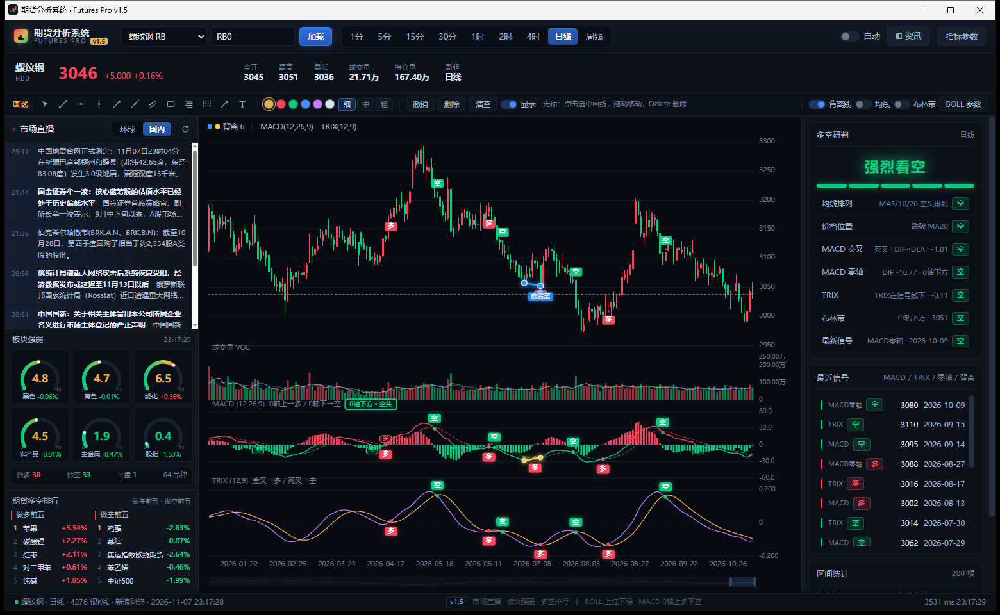
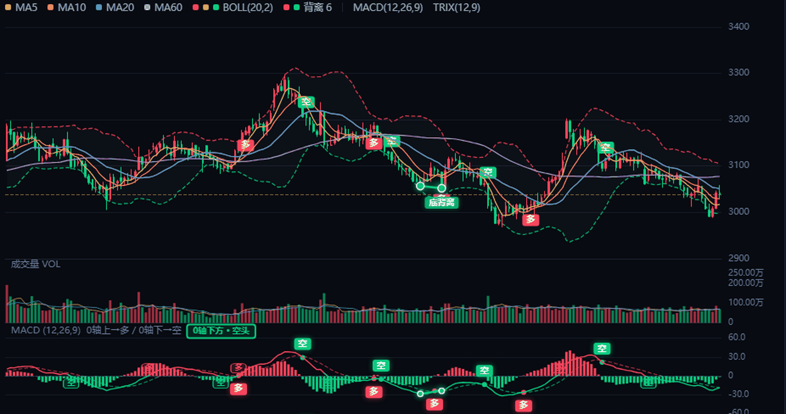
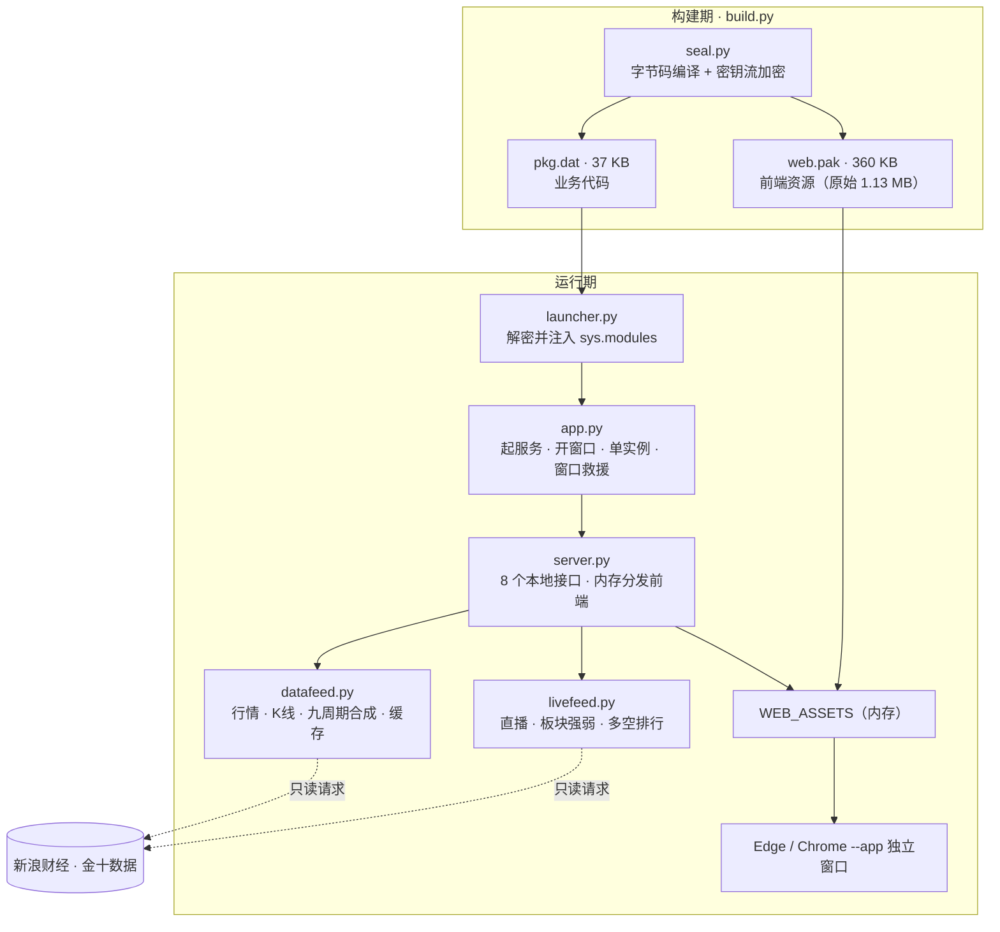

<div align="center">

<h1>期货分析系统 · Futures Pro</h1>

<p><strong>73 个期货品种 · 9 个周期 · 五层指标 · 一条能复核的背离线 · 13 MB 单文件双击即用</strong></p>

<p>想看的东西全在一屏里，判断依据全部写在图上。</p>




</div>

> [!NOTE]  
> 本项目用于技术学习与研究，数据来自第三方公开接口，**不构成任何投资建议**，请勿用于实盘决策。

---

## 目录

- [它解决什么问题](#它解决什么问题)
- [核心特色](#核心特色)
- [背离线：把"感觉背离"变成证据](#背离线把感觉背离变成证据)
- [一屏作战室](#一屏作战室)
- [技术架构](#技术架构)
- [几个不太显眼的工程细节](#几个不太显眼的工程细节)
- [快速开始](#快速开始)
- [自己打包 EXE](#自己打包-exe)
- [目录结构](#目录结构)
- [数据来源](#数据来源)
- [已知边界](#已知边界)
- [版本演进](#版本演进)

---

## 它解决什么问题

一个人盯盘，真正消耗精力的不是"看 K 线"，而是三件事：

| 损耗          | 具体表现                                  | 本项目的做法                         |
| ----------- | ------------------------------------- | ------------------------------ |
| **注意力被切碎**  | 行情软件看 K 线、网页看资讯、另一个窗口看板块，切一次窗口重建一次上下文 | 左（资讯/板块/排行）· 中（图表）· 右（研判）压进同一屏 |
| **判断标准不稳定** | "这里算不算背离""均线算不算多头排列"，换个人、换个心情答案就不一样   | 背离、交叉、排列、打分全部算法化，结论带坐标可回溯      |
| **工具链太重**   | 专业终端贵、要账号、数据在云端；轻量网页工具功能单薄、必须联网登录     | 单文件 13 MB，双击就跑，行情只读拉取，本地不留账号   |

中间那一档——**功能够用、隐私可控、随手可用**——长期是空的。这个项目就是补这一档。

---

## 核心特色

### 1 · 背离线：主图与副图同步画线

|         | 定义                            | 图上表现                                 | 含义             |
| ------- | ----------------------------- | ------------------------------------ | -------------- |
| **顶背离** | 价格创新高，MACD 快线 DIF 的高点却低于上一个高点 | K 线与 MACD 各连一条**红色**实线，两端白边圆点，标「顶背离」 | 上涨动能衰减 → 找做空机会 |
| **底背离** | 价格创新低，DIF 的低点却高于上一个低点         | 同位置连**绿色**实线，标「底背离」                  | 下跌动能衰减 → 找做多机会 |



*上图：同一个时间窗口内，主图连接两个价格低点，MACD 副图连接对应的两个 DIF 低点，落差一眼可见。*

### 2 · 五层指标体系

指标不是越多越好，而是要有分层逻辑：趋势 → 通道 → 动能 → 力度，加量能共五层。

| 层级 | 指标                        | 回答的问题     |
| -- | ------------------------- | --------- |
| 趋势 | MA5 / MA10 / MA20 / MA60  | 方向对不对     |
| 通道 | 布林带 BOLL(20, 2)           | 现在偏贵还是偏便宜 |
| 量能 | VOL + VOL MA5 / MA10      | 有没有资金配合   |
| 动能 | MACD(12, 26, 9) · 0 轴上红下绿 | 动能是强还是弱   |
| 力度 | TRIX(12, 9)               | 中期趋势有没有转向 |

全部参数可在「指标参数」里改，改完即时重绘并存本地，下次打开还是你的设置。

### 3 · 左栏：宏观 → 中观 → 微观

- **市场直播**：环球 / 国内双标签，实时财经快讯。地域归属由词表驱动（"美联储、非农、OPEC" 等全球词 vs 国内政策词命中数加权），避免把外盘消息塞进国内栏。
- **板块强弱**：黑色 / 有色 / 能化 / 农产品 / 贵金属 / 股指 六组，0–10 强度分驱动弧形仪表。分数 = 板块平均涨幅 62% + 上涨品种占比 38%，涨幅用双曲正切压缩，极端行情不会把仪表顶爆。
- **多空排行**：做多前五 / 做空前五。排序不是只看涨幅，而是 `涨幅 + 持仓变化 × 0.08`——**增仓上涨和减仓上涨不是一回事**，权重虽小，足以把真金白银进场的品种顶上来。

### 4 · 右栏：结论 + 依据 + 历史

- **六维研判**：均线排列、价格位置、MACD 交叉、MACD 零轴、TRIX、布林带，六项各自给出多/空/中性，汇总为「强烈看多」→「强烈看空」。
- **最近信号**：MACD 金叉死叉、TRIX 金叉死叉、零轴穿越、顶底背离，按时间倒序，每条带日期与价格。
- **区间统计**：跟随当前可见区间自动重算涨跌幅、振幅、成交量，缩放图表即刷新。

### 5 · 桌面程序的外观，不是网页的样子

- 独立窗口，**无地址栏、无标签页、无工具栏**
- 屏蔽鼠标右键、`F12`、`Ctrl+Shift+I`、`Ctrl+U`、`Ctrl+S`、`Ctrl+P`、`Ctrl+±`、`Alt+←/→` 等浏览器功能键
- 禁止选中文字、拖拽图片、拖入文件；中键不滚动
- 标题栏 / 任务栏 / Alt+Tab 图标均为程序自己的图标，启动底色即深色，不闪白屏
- **保留**：输入框右键粘贴、`Esc` 关弹窗、`Ctrl+Z` 撤销画线、`Delete` 删画线、`Ctrl+R` 刷新行情、滚轮缩放 K 线

### 6 · 零依赖 · 单文件 · 本地优先

| 指标    | 数值                                                                 |
| ----- | ------------------------------------------------------------------ |
| 期货品种  | **73** 个（上期所 16 / 能源中心 5 / 大商所 21 / 郑商所 20 / 中金所 8 / 广期所 3）        |
| K 线周期 | **9** 种（1 / 5 / 15 / 30 分，1 / 2 / 4 时，日线，周线）                       |
| 本地接口  | **8** 个（quote / kline / catalog / live / market / ping / hb / bye） |
| 自研代码  | **5,641** 行（Python 1,916 + 前端 3,725）                               |
| 第三方依赖 | **0** —— 全部使用 Python 标准库                                           |
| 分发包   | **13.3 MB** 单文件 EXE，免安装、免 Python                                   |

---

## 背离线：把"感觉背离"变成证据

背离是技术分析里最容易被主观化的一环。传统做法靠肉眼在 K 线和 MACD 之间来回比对，标准因人而异，事后也无法证明当时是否看错。系统把它拆成可计算的四步：

| 步骤        | 做法                                                             | 为什么这样做                |
| --------- | -------------------------------------------------------------- | --------------------- |
| **① 找极点** | 以左右各 3 根 K 线为窗口，只有比左右都高（或都低）的才算摆动极点                            | 天然过滤单根插针造成的假极点        |
| **② 配对**  | 只在**相邻两个极点**之间比较，两点至少相隔 5 根 K 线                                | 避免同一波段的毛刺被误判成两次冲高     |
| **③ 比对**  | 顶背离：`价格更高 且 DIF 更低`；底背离：`价格更低 且 DIF 更高`，差值需超过动态阈值（DIF 绝对值的 6%） | 阈值随波动自适应，小波动品种不会被噪声刷屏 |
| **④ 呈现**  | 主图连价格极点，副图连 DIF 极点，同色、同区间、同标注                                  | 结论不再是"我觉得"，而是一条带坐标的证据 |

三个参数可调：**摆动跨度**（默认 3）、**最小间隔**（默认 5）、**最多条数**（默认 6）。

> [!IMPORTANT]  
> 极点必须等右侧再走完 3 根 K 线才能确认，所以**最新几根不会立刻出线**。这是刻意不做未来函数的结果，不是漏信号。  
> 背离线是"警示"，建议配合 MACD 交叉、0 轴位置、均线排列一起判断。嫌信号少，把摆动跨度调到 2、最小间隔调到 3。

---

## 一屏作战室

| 区域     | 放什么                                              | 回答的问题   |
| ------ | ------------------------------------------------ | ------- |
| **左栏** | 市场直播（环球 / 国内）· 板块强弱六仪表 · 做多前五 / 做空前五             | 环境怎么样   |
| **中央** | K 线 + MA + BOLL + 成交量 + MACD + TRIX + 背离线 + 画线工具 | 结构怎么样   |
| **右栏** | 六维研判 · 最近信号 · 区间统计                               | 结论靠什么支撑 |

三块不是并列堆放，而是**同一个时间轴上的三层证据**：左边告诉你「环境」，中间告诉你「结构」，右边告诉你「结论及其依据」。任何一条结论，都能在另外两块找到支撑或反证。

---

## 技术架构



**为什么不是 Electron，也不是纯网页**

| 方案                       | 体积        | 依赖             | 隐私      | 结论            |
| ------------------------ | --------- | -------------- | ------- | ------------- |
| Electron                 | 80–150 MB | 需打包整套 Chromium | 本地      | 太重，启动慢        |
| 纯网页 + 云服务                | 小         | 要域名、要登录        | 行情经过第三方 | 隐私与"随手可用"都不达标 |
| **标准库 HTTP + 系统自带浏览器内核** | **13 MB** | **0**          | **全本地** | 本项目选择         |

后端是 `ThreadingHTTPServer`，前端是原生 JS + ECharts，用 `--app=` 把浏览器变成无边框窗口。**整套方案不引入任何第三方运行时**，所以单文件能压到 13 MB，也不会有"装不上依赖"这种问题。

---

## 几个不太显眼的工程细节

真正决定"像不像软件"的，往往是这些地方：

**① 窗口被系统丢到屏幕外时自动救回。**  
Edge 的 `--app` 窗口偶发被恢复成负坐标：实测遇到过 `(-25984, -25600)`、尺寸 `128×22` ——进程活着、窗口"存在"，但屏幕上什么都没有，用户只看到程序闪一下就没了。处理方式是区分「有窗口对象」和「真正可见（≥200×150）」，用 `ShowWindow(9)` + `MoveWindow` 拉回主屏；18 秒仍未真正显示，才回落 `startfile` 用默认浏览器打开。

**② 心跳退出，不靠进程存活判断。**  
页面每几秒 `POST /api/hb`，关闭时 `sendBeacon('/api/bye')`。服务端只认心跳：浏览器崩溃、被强杀、窗口没开，都不会留下僵尸进程。反过来，页面刷新也不会误判成退出。

**③ 前端资源从内存分发。**  
打包后资源不落盘，`WEB_ASSETS` 是解密后的字典，`server.py` 按路径直接吐 bytes，并统一 `Cache-Control: no-store`；HTML 里的 js/css 引用在打包时自动加 `?v=<版本>`。这条是踩坑换来的——早期升级后用户看到的还是旧界面，原因是浏览器缓存了 `app.js`。

**④ 屏蔽右键，但只拦默认行为，不阻断冒泡。**  
`preventDefault` 而不 `stopPropagation`：否则画线模块的"右键取消落点"、`Ctrl+Z` 撤销、`Ctrl+R` 刷新行情会一起失效。输入框、文本域单独放行，保证能粘贴代码。

---

## 快速开始

### 方式一：直接用 EXE（推荐给普通用户）

到 **[Releases](../../releases)** 下载 `期货分析系统.exe`，双击即可。免安装、免 Python、免配置。

### 方式二：跑源码

```bash
git clone https://github.com/winop547-beep/Futures-Pro.git
cd Futures-Pro
python app.py
```

要求 **Python 3.9+**，不需要 `pip install` 任何东西。程序会自动开一个独立窗口；若系统没有 Edge / Chrome，则回落到默认浏览器。

只想跑本地服务：

```bash
python app.py --server-only
# 终端会打印 http://127.0.0.1:505xx/
```

---

## 自己打包 EXE

```bash
pip install pyinstaller
python build.py
```

产物：`dist/期货分析系统.exe`（单文件，约 13 MB，版本号写在 EXE 属性里）。

打包会先经过 `seal.py`：业务模块编译成字节码、用随机密钥做流加密，运行时由 `launcher.py` 解密后直接注入内存执行；前端 HTML/CSS/JS 同样加密进 `web.pak`，运行期才解到内存分发。因此 EXE 二进制里搜不到源码明文，也搜不到前端的函数名和中文标签。

---

## 目录结构

```
futures_pro/
├── app.py            # 桌面启动器：起服务、开窗口、窗口救援、单实例
├── server.py         # 本地 HTTP 服务与 8 个接口（内存分发前端资源）
├── datafeed.py       # 行情 / K 线 / 九周期合成 / 缓存
├── livefeed.py       # 市场直播、板块强弱、多空排行
├── seal.py           # 构建期加密（字节码 + 密钥流 XOR）
├── launcher.py       # 运行期解密入口（注入 sys.modules）
├── build.py          # 一键打包（PyInstaller onefile + 版本资源）
├── make_icon.py      # 生成 app.ico
├── app.ico           # 程序图标
├── web/
│   ├── index.html    # 页面结构
│   ├── style.css     # 深色主题
│   ├── app.js        # 图表、指标、背离检测、研判
│   ├── draw.js       # 画线工具
│   ├── guard.js      # 桌面化防护（右键 / 快捷键 / 选中）
│   └── echarts.min.js
└── docs/
    ├── screenshot.png
    └── divergence.png
```

---

## 数据来源

| 用途       | 来源                             | 说明               |
| -------- | ------------------------------ | ---------------- |
| 行情报价、K 线 | 新浪财经 `hq.sinajs.cn` / 新浪 K 线接口 | GBK 编码，批量请求      |
| 财经快讯     | 金十数据 `flash-api.jin10.com`     | 需 `x-app-id` 请求头 |
| 备用       | 东方财富                           | 主源异常时兜底          |

均为公开接口，程序只做**只读**请求，不写入、不上传任何本地数据。接口若调整，对应模块需要跟着改。

---

## 已知边界

写清做不到的事，比列一堆优点更有用：

1. **不做胜率宣称。** 系统只呈现结构，不预测价格。背离线是"动能与价格出现分歧"的提示，不是买卖点。
2. **信号有滞后。** 摆动极点需右侧 3 根 K 线确认，所以最新几根不会立刻出线。刻意不做未来函数，代价就是晚 3 根。
3. **依赖第三方数据。** 新浪 / 金十都是公开服务，延迟、限频、字段变动不受本项目控制；夜间、节假日或接口变更时可能取不到数据。
4. **本地程序没有绝对防护。** 加密能挡住直接翻文件、看源码，挡不住调试器挂进程。
5. **启动需几秒。** 单文件 EXE 要先解包再起服务，冷启动约 15–20 秒；源码模式快很多。
6. **仅 Windows。** 窗口救援、图标替换用了 Win32 API，macOS / Linux 下只能跑 `--server-only` 然后手动开浏览器。

---

## 版本演进

| 版本       | 主要变化                                           |
| -------- | ---------------------------------------------- |
| v1.0     | K 线 + 均线 + BOLL + VOL + MACD + TRIX，九周期切换，画线工具 |
| v1.1     | MACD / 布林带分色，0 轴上红下绿，金叉死叉「多/空」标记               |
| v1.2     | 左栏市场直播（环球 / 国内）、板块强弱仪表、做多前五 / 做空前五             |
| v1.3     | 加密分发：字节码 + 密钥流加密，单文件 EXE 免安装                   |
| v1.4     | 桌面化加固：屏蔽右键与开发者工具、自定义图标、深色启动                    |
| **v1.5** | **背离线：价格与 MACD 快线背离识别，主图与副图同步画线**              |

---

<div align="center">

**看清结构，再谈方向。**

如果这个项目对你有帮助，点个 ⭐ 就是最好的支持。

</div>
